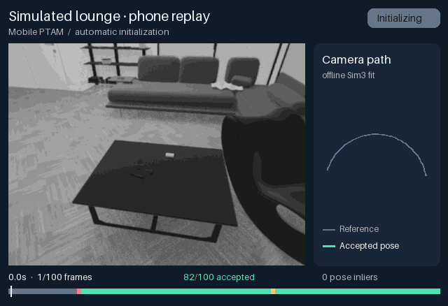

# iPTAM

[](updated/README.md#updated-and-ported-for-modern-hardware) **[Updated and ported for modern hardware](updated/README.md#updated-and-ported-for-modern-hardware)**

**PTAM camera tracking, restored for modern iPhones.**

This project brings the 2010 iPhone port of **Parallel Tracking and Mapping**
back to life with a portable C++ core, a modern iOS app, recorded-data tests,
and an experimental variant inspired by the mobile PTAM paper.
It estimates camera motion from image patches and builds a sparse map.
ARKit poses, depth and IMU data are not used for tracking.



*Saved iPhone replay of a simulated lounge. The full 10-second sequence includes
initialization and a weak frame: **82/100 frames accepted**. Camera paths are
visualized offline; this is not a screen recording or a frame-rate benchmark.
GIF: 1.85 MB.*

## How well does it work?

The mobile variant improves the simulated lounge results. Real recordings still
expose substantial failures, so this remains a **research prototype**, not a
reliable room-scanning app.

| Recording | Original PTAM | Restored iPTAM | Mobile variant |
| --- | ---: | ---: | ---: |
| Simulated lounge · historical | 57 / 230 | 44 / 230 | **142 / 230** |
| Simulated lounge · new motion | 33 / 100 | 71 / 100 | **82 / 100** |
| EuRoC MH01 · left camera | 366 / 3,682 | **932 / 3,682** | 329 / 3,682 |
| EuRoC MH01 · right camera | **557 / 3,682** | 234 / 3,682 | 1 / 3,682 |
| Real lounge · sparse keyframes | 0 / 142 | 0 / 142 | 0 / 142 |

Numbers are visually supported frames over the **whole input**, including
initialization and lost intervals. Original/restored PTAM use fixed image pairs;
the mobile system selects its second view automatically. The original engine's
support diagnostics also differ. These are whole-system results, not an isolated
tracker ranking.

All three mobile new-lounge repeats accept the same 82 frames, with 2.4–4.2 cm
fitted position RMS on that subset. Their poses vary under timed mapping.
The full [results and limitations](docs/RESULTS.md) include coverage, tracking
gaps, equal-timestamp comparisons and per-trial data.

## Try it

Build and test the experimental mobile core on the host:

```sh
cmake -S . -B build-mobile -DCMAKE_BUILD_TYPE=Release -DIPTAM_MOBILE_PAPER=ON
cmake --build build-mobile -j 4
ctest --test-dir build-mobile --output-on-failure
```

For the iPhone app, use macOS with Xcode and your own signing team:

```sh
IPTAM_DEVELOPMENT_TEAM=YOUR_TEAM_ID bash scripts/build_ios.sh mobile
```

The app opens a recording library. Select a prepared recording to replay its
images and timestamps; camera permission is not needed. See the
[build and replay guide](docs/BUILDING.md) for signing, dataset formats and
other build variants.

## Explore the project

- [Results](docs/RESULTS.md) — measurements, failures and downloadable tables.
- [Build and replay guide](docs/BUILDING.md) — host, iOS and test commands.
- [Mobile implementation](docs/testing/mobile-implementation.md) — algorithms and engineering choices.
- [Original report](iPTAM%20report.pdf) and [restoration analysis](docs/report-analysis.md) — what the original port attempted and what needed fixing.
- [Upstream comparison](upstream/README.md) — the separately built Oxford PTAM baseline.

The modern app is in `ios/`; the C++ core and bundled libraries are under
`xPTAMclean/`. The old Xcode project is retained for historical reference.

## Attribution and licensing

Original iPhone port by Aaron Wetzler, based on PTAM by Georg Klein and David
Murray. The mobile variant is inspired by their
[2009 camera-phone paper](https://www.robots.ox.ac.uk/~dwm/Publications/Papers/klein_murray_ismar2009/klein_murray_ismar2009.pdf).
It is a new implementation on the restored core, not the historical commercial
phone source. See [component licenses and original notices](LICENSES.md).
