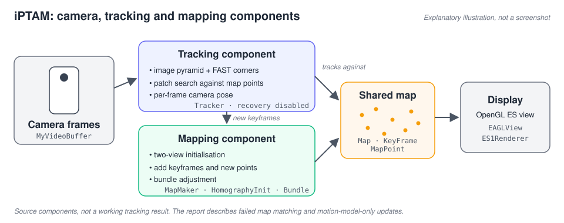

# iPTAM

[](xPTAMclean)
[](xPTAMclean/xPTAM.xcodeproj)
[](#validation-and-limitations)

iPTAM is an incomplete iPhone port of PTAM (Parallel Tracking and Mapping), the monocular camera
tracking and mapping system by Georg Klein and David Murray. The repository combines C++ tracking
and mapping code with an Objective-C camera/display layer and trimmed copies of LibCVD (`iCVD`)
and TooN (`iTooN`). It preserves the port and its report rather than a maintained iOS application.



*Architecture schematic using source component names. It is not a screenshot or evidence that the port runs.*

## Source organization

[MyVideoBuffer.mm](xPTAMclean/MyVideoBuffer.mm) configures AVFoundation capture, converts frames
for the tracker and passes them to the PTAM wrapper. The `iPTAM` directory contains the tracker,
map maker, keyframes and map points; the display layer uses OpenGL ES. `MapMaker` inherits from
`CVD::Thread` and its constructor calls `start()`. That source structure does not establish
successful mapping, which the report explicitly says was failing. The intended outputs are
camera pose and a sparse map displayed over camera frames, not a dense reconstruction or a
supported file-export format.

See the [original port report](iPTAM%20report.pdf) for the implementation discussion and historical
limitations. Its results belong to the original experiment, not to a current device validation.

## Historical build procedure

Open [xPTAM.xcodeproj](xPTAMclean/xPTAM.xcodeproj) in Xcode. The saved project targets the iOS 4.1
SDK and 32-bit architectures, uses an iPhone Developer signing identity, and links UIKit,
AVFoundation, OpenGL ES and other Apple frameworks. The original instructions required a
provisioned iPhone running iOS later than 4.0.

Those settings are historical requirements. A current Xcode installation is not sufficient
evidence of buildability: SDK availability, removed APIs, architecture settings and signing must
be evaluated before attempting a port. There is no verified current installation command.

## Validation and limitations

Review date: 2026-11-12.

This documentation revision reviewed the project settings, camera/display integration and original report. It did
not compile the app, install it on an iPhone, test pose tracking or measure runtime performance.
No automated test suite or current build record is included.

The original report describes successful planar initialization followed by a failure to match map
points. Recovery was disabled to continue motion-model updates; the report explicitly says that
true closed-loop tracking and further map building were not taking place. It reports drift and
scale problems. This is a historical failure account, not a newly reproduced result. The port is
unmaintained, and camera calibration, tracking and resource use need independent validation on
any target device. The diagram shows component structure, not successful operation of that chain.

## License

The component paths are `xPTAMclean/iPTAM/`, `xPTAMclean/iCVD/` and `xPTAMclean/iTooN/`.
No single license is established for the entire repository. The notices below do not establish
terms for the wrapper/project files, including `xPTAMclean/Classes/`, `MyVideoBuffer.mm` and
`xPTAM.xcodeproj`; no independent license declaration for those files was established in this
review.
The original component notices below are retained verbatim. The PTAM download URL is historical.

All files in the iPTAM folder fall under this license agreement: http://www.robots.ox.ac.uk/~gk/PTAM/download.html

### LibCVD

All files for LibCVD fall under this license agreement which should be in every file in the iCVD directory:

```
/*
        This file is part of the CVD Library.

        Copyright (C) 2005 The Authors

        This library is free software; you can redistribute it and/or
        modify it under the terms of the GNU Lesser General Public
        License as published by the Free Software Foundation; either
        version 2.1 of the License, or (at your option) any later version.

        This library is distributed in the hope that it will be useful,
        but WITHOUT ANY WARRANTY; without even the implied warranty of
        MERCHANTABILITY or FITNESS FOR A PARTICULAR PURPOSE.  See the GNU
        Lesser General Public License for more details.

        You should have received a copy of the GNU Lesser General Public
        License along with this library; if not, write to the Free Software
        Foundation, Inc.,
    51 Franklin Street, Fifth Floor, Boston, MA  02110-1301  USA
*/
```

If you find a file in that directory which does not contain this license heading then add this heading and abide by the terms.

### TooN

All files for TooN fall under this license agreement which should be in every file in the iTooN directory:

```
// -*- c++ -*-

//     Copyright (C) 2009 Tom Drummond (twd20@cam.ac.uk)
//
// This file is part of the TooN Library.  This library is free
// software; you can redistribute it and/or modify it under the
// terms of the GNU General Public License as published by the
// Free Software Foundation; either version 2, or (at your option)
// any later version.

// This library is distributed in the hope that it will be useful,
// but WITHOUT ANY WARRANTY; without even the implied warranty of
// MERCHANTABILITY or FITNESS FOR A PARTICULAR PURPOSE.  See the
// GNU General Public License for more details.

// You should have received a copy of the GNU General Public License along
// with this library; see the file COPYING.  If not, write to the Free
// Software Foundation, 59 Temple Place - Suite 330, Boston, MA 02111-1307,
// USA.

// As a special exception, you may use this file as part of a free software
// library without restriction.  Specifically, if other files instantiate
// templates or use macros or inline functions from this file, or you compile
// this file and link it with other files to produce an executable, this
// file does not by itself cause the resulting executable to be covered by
// the GNU General Public License.  This exception does not however
// invalidate any other reasons why the executable file might be covered by
// the GNU General Public License.
```

If you find a file in that directory which does not contain this license heading then add this heading and abide by the terms.
