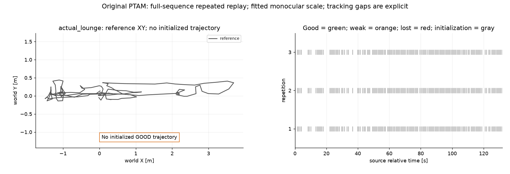

# Sparse real lounge export

> Detailed validation record. See [current results](../RESULTS.md) for the main comparison.
> `evidence/` labels identify local validation artifacts; raw logs, app binaries
> and private inputs are not redistributed with this repository.

The provided LiteReality export contains sparse RGB keyframes from a real lounge.
The original archive is retained privately as `LiteReality-export.tar`, with
local provenance labeled `evidence/raw_source/`.
The archive is 208,681,984 bytes, SHA256
`e581c8cedd6522eb6dbc885fdceb3f3f78d5e44d138d01dab7ae7707aa0a6949`.
The export includes a 355,887-point cloud, depth/confidence images, RoomPlan files and camera metadata. Those assets
are preserved and never enter the monocular PTAM estimator.

## Images and calibration

There are 142 unique `frame_NNNNN.jpg` images and matching JSON sidecars at the
export root. The copies under `images/` have identical JPEG hashes; AppleDouble
`._*` files are ignored. Original images are 1920×1440 in sensor orientation.
The 7,945 camera metadata samples do not supply 7,945 RGB images. This is a sparse
keyframe export rather than the original full frame-rate video: image times span
131.903 seconds, with median spacing 0.750301 seconds and a maximum gap of
4.335116 seconds. The first image is visibly blurred.

Each image's row-major 3×3 intrinsics and 4×4 `cameraPoseARFrame` exactly match
the column-major `cameraIntrinsics` and `worldFromCameraTransform` of its recorded
camera sample, at precisely equal timestamps. The separately saved inverse
transform agrees within 7.2e-7. The source focal varies from 1335.999 to 1364.688
pixels. It is normalized per exposure rather than assuming one source K.

`tools/prepare_actual_lounge.py` creates an independent input directory at
`evidence/actual_datasets/actual_lounge`:

- All 142 images remain in their original order and retain their source-time gaps.
- A 3× area downsample uses the pixel-center adjustment for K, followed by bilinear
  remapping to a common 640×480 pinhole K `[460,460,319.5,239.5]`. Every target pixel
  has source support. No display-orientation rotation changes the camera frame.
- The export has no distortion coefficients or lookup. Its supplied K supports a
  documented pinhole approximation, not a claim of newly measured undistortion.
- The input manifest contains pixels, intrinsics and timestamps. ARKit poses live
  separately in `reference.json`, labeled **device reference, not ground truth**.
  Only the 141 `normal` ARKit states are references; the first limited state is
  excluded from reference scoring while its image remains in the input.

Every output image was regenerated independently and matched the saved PGM
exactly. Concatenated output pixel SHA256 is
`9e3da201bfbd1f475fa6292c315cb4418ca85367c8502e53301353ec8ed46fd4`.
The reproduction record is `testing/host/actual_lounge_reproduction_20261112.json`.

## Independent image check and initialization

The exported ARKit camera transform is converted once to optical CV axes by
right multiplication with `diag(1,-1,-1,1)`. A separate actual-image audit used
GFTT/LK correspondences with forward/back checks and image-only fundamental
RANSAC. Across 51 usable adjacent pairs, the median of pairwise epipolar medians
was **0.634 pixels** with the converted axes, versus **35.325 pixels** with the
intentionally unconverted ARKit axes. This checks serialization, association and
axis convention; it does not make ARKit independent ground truth.
Evidence: `testing/host/actual_lounge_epipolar_axes_20261112.json`.

Initialization selection read no reference poses. The original fixed candidate
grid found no pair meeting the existing geometry and 80-followup-frame rules.
A reproducible exhaustive pass of all 281 adjacent and one-skipped pairs used
those same rules. It selected **47/48**: 100 persistent image tracks, 73 essential
cheirality inliers, median rotation-corrected parallax 2.02°, and 39 homography
inliers. Later image-supported pairs were retained in the analysis but excluded
by the fixed followup rule. The prepared manifest remains unchanged with its
initial 1/2 suggestion; tests use explicit 47/48 overrides.

```bash
.venv/bin/python tools/select_visual_initialization.py \
  --datasets-root data/prepared \
  --datasets actual_lounge --all-adjacent --minimum-followup-frames 80 \
  --output evidence/host/FRESH_CANDIDATES
.venv/bin/python tools/audit_actual_lounge.py \
  --dataset data/prepared/actual_lounge \
  --output evidence/host/FRESH_AXIS_AUDIT.json
```

## Actual tracking outcome

The final cleanup/support-corrected host core, SHA256
`a319cbc477f734d08cf4fbf1690b2ff6bb2673adaba7881dd9161dc9f7717654`,
processed all 142 images in three full repetitions using pair 47/48. Every
repetition remained uninitialized: **0/142 GOOD frames**, no map, no nonfinite
saved transforms and no numerical rejection. Pose/state output was identical
across repetitions. A complete diagnosed initialization rejection is a tracking
outcome (CLI exit2), distinct from an input error or crash. The harness initially
misclassified that exit as fatal; its first artifact is preserved, and the
corrected harness then recorded all three full results under
`testing/host/final_support_actual_lounge_20261112`.

The sequential physical iPhone12 test `validated_support_actual_lounge_01`, app
SHA256 `dc0e3d2b551468e4e2013163c9e0873295a5c9d334a805be6d2c11b02a6c8d74`,
also verified and processed **142/142** input images with pair 47/48, correct
model/pixel hashes, zero hard numerical rejection and **0 visual tracking**.
It did not initialize; no trajectory accuracy is reported. Its ~1.63 ms average
is the cost of the uninitialized path, not successful tracking speed. The device
reported thermal state 2 (serious), with low power mode off.

An earlier `restored_cleanup_actual_lounge_01` phone trial collided with a
separate lifecycle test and is explicitly invalidated. It is excluded from
estimator conclusions; the final `validated_support_actual_lounge_01` is a
separate valid sequential trial. The corrected phone helpers now share a per-device lock, checked by a real two-process test.

The input pipeline works on the phone; PTAM does not track this sparse capture.
Missing RGB exposures are not reconstructed from ARKit poses or inserted as
synthetic frames. This result remains a failure against the requested actual
lounge tracking objective.


