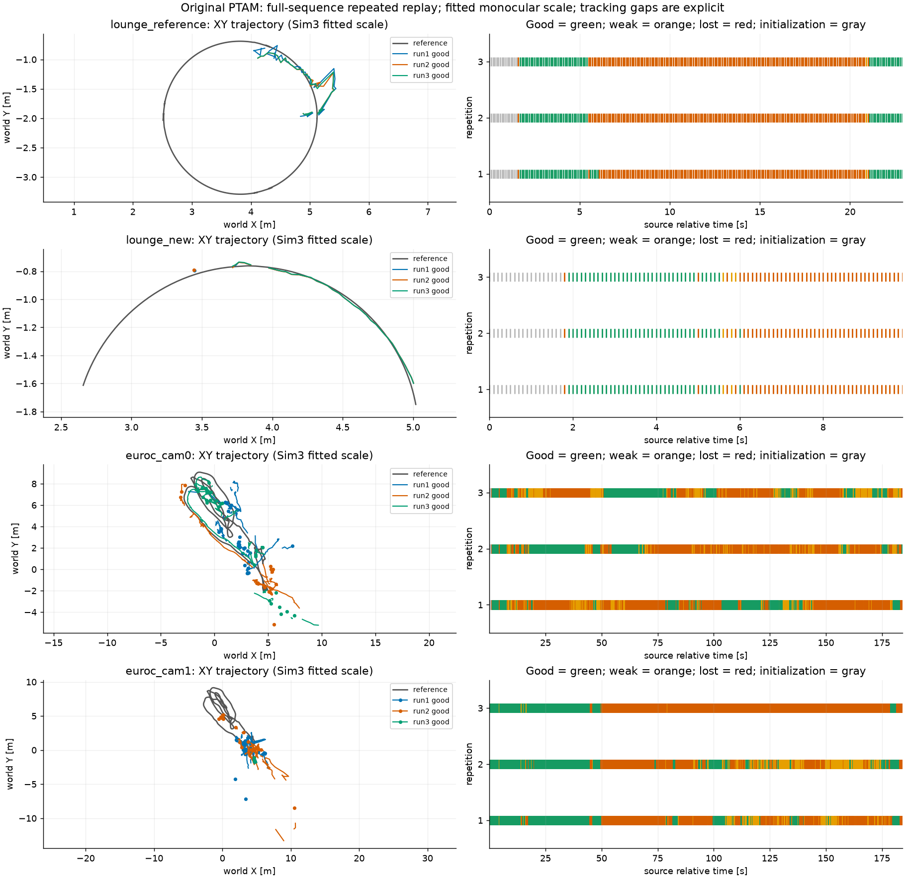

# Archived baseline and numerical-loop investigation

> Detailed validation record. See [current results](../RESULTS.md) for the main comparison.
> `evidence/` labels identify local validation artifacts; raw logs, app binaries
> and private inputs are not redistributed with this repository.

This preserves the earlier report before the native equidistant model and accepted-step transaction fixes. It is not the current validation status.

# Host replay validation

The baseline completed all four full input sets three times. It did not provide stable full-sequence visual tracking. A subsequent deterministic version completed three datasets consistently but encountered an internal NaN bundle-adjustment loop on EuRoC cam1. Its process was stopped, evidence preserved, and the solver is being repaired before another full suite.

## Retained baseline

Evidence: `evidence/host/baseline_20261112_1830`. Binary SHA256 `3018855ae1a9761b7a9cbae8e9d6de4394c48c6cf6dd16e770d291e7e99dfafd` is preserved under `binary/iptam_replay`.

| Input | Initialization | Strict-good frames, three runs | First-run Sim3 RMS | First-run motion coverage | Identical pose/state output | Peak RSS | Worst frame |
| --- | --- | --- | --- | --- | --- | --- | --- |
| lounge_reference | 0/16 | 62, 57, 57 / 230 | 0.190 m | 21.1% | no | 21.8 MiB | 6.2 ms |
| lounge_new | 0/18 | 37, 37, 36 / 100 | 0.019 m | 48.1% | no | 21.3 MiB | 7.4 ms |
| euroc_cam0 | 0/20 | 929, 1128, 1192 / 3682 | 2.805 m | 26.8% | no | 147.1 MiB | 100.5 ms |
| euroc_cam1 | 0/5 | 1298, 1433, 1000 / 3682 | 3.695 m | 19.1% | no | 204.7 MiB | 404.8 ms |

Strict GOOD requires quality2, at least ten visual measurements, a nonempty map and a finite rigid transform. Weak quality1 is reported separately. Motion coverage counts reference path length only where adjacent original exposures both have strict-good output; no line or metric bridges a lost segment. Sim3 fits arbitrary monocular scale. RMS is on each run’s actual valid reference-associated subset, so accuracy values with different coverage are not directly interchangeable. Endpoint means last scored valid exposure, not necessarily the recording end. No ground-truth score selected initialization.

## Numerical failure preserved

The interrupted suite is `evidence/host/final_20261112_frozen`, binary SHA256 `e0d4c505618b63aec534142975a63aa3ddc5ef3c53911409225d49b0bd2cc829`. Its lounge-reference, lounge-new and left-EuRoC repetitions were exactly identical in non-runtime output fields, with44/230,42/100 and493/3682 strict-good frames. This establishes repeatability of those outputs, not full tracking success.

Right-EuRoC frame800 was the last progress message before an unbounded NaN map-update retry loop. The raw489,316,222-byte stderr log,5,104,213 `NANNERY!` events, first matrices, command and manual-stop record remain under `euroc_cam1/repeat_01`. That suite is incomplete; its other two right-camera repetitions were not attempted. Saved output-pose finite checks alone did not detect internal numerical failure.

The harness now watches internal numerical diagnostics, stops the affected child and halts the suite before repeating a known failure. An actual looping-child test verifies termination and evidence retention. The solver repair must first pass a bounded reproducing prefix and numerical fixtures, followed by a new full suite.

## Data and independent checks

Two lounge inputs are separate synthetic motions through the photo-fitted lounge scene. EuRoC inputs are the left and right cameras of the same real MH_01_easy recording, processed separately as monocular input. These are not four independent physical environments. ARKit outputs are comparison/reference values, not independent ground truth.

All four camera/reference axis conversions agree independently with tracked image features: median epipolar error0.166–0.184 pixels versus5.9–19.6 pixels after deliberately applying the render/CV conversion a second time. See `reference_axes_audit.json` and [dataset-inventory.md](../dataset-inventory.md) for calibration, source paths, clock, rectification and evaluation contracts. Five Python contract/watchdog tests pass.
