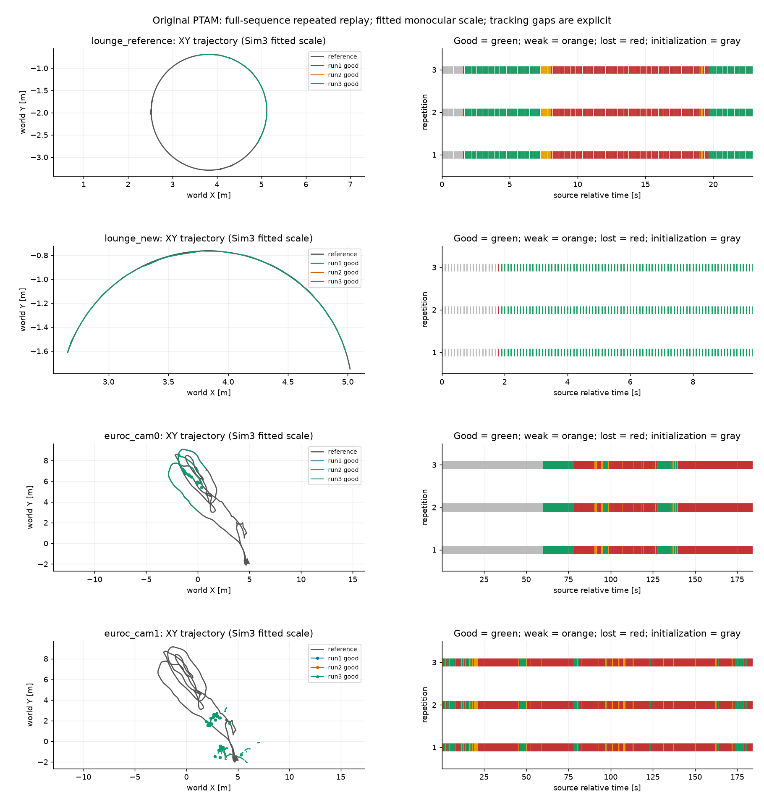

# Cleanup profile control before the support guard

> Detailed validation record. See [current results](../RESULTS.md) for the main comparison.
> `evidence/` labels identify local validation artifacts; raw logs, app binaries
> and private inputs are not redistributed with this repository.

Exact equidistant optics restore continuous post-initialization tracking of the
new synthetic lounge on the physical iPhone12: 81/81 exposures, 6.15mm fitted-scale
position RMS, repeated exactly three times. The actual lounge scan does not
initialize, and the historical lounge and real EuRoC sequences still lose long
sections. The requested general tracking stability has not been achieved.

This preserved control profile restores mandatory bad-point cleanup in the serial
mapper and prevents retired points from being reinserted. It keeps bounded,
transactional solver safeguards with the original adaptive damping default
(minimum0). The fixed1e-6 floor is a [rejected control](damping-floor-control.md).
No weak-keyframe gate, relaxed bootstrap or ground-truth pose input is enabled.
The host and phone binaries below identify the exact tested implementations.

## Physical iPhone results

Target: physical iPhone 12 (iPhone13,2), iOS 18.0.1. App executable SHA256:
`d270bfc7e5e4c569e434af1582858f3b8581120971574bc4facbed60a00ce26c`.
App/source/build provenance is under `testing/builds/d270bfc7e5e4c569` in the local evidence archive.
These are actual recorded-input runs on the physical phone, not live handheld
accuracy measurements. Detailed device checks belong in [phone-validation.md](phone-validation.md).

Each evidence directory under `evidence/phone/`
contains input/time/model/pixel checks, app provenance, complete trajectory rows
and `evaluation.json`.

| Evidence ID | Model; init | GOOD / input | Weak | Fitted position RMS | Reference motion covered | Largest gap | Hard / retained stops | Mean / max processing |
| --- | --- | --- | --- | --- | --- | --- | --- | --- |
| `restored_cleanup_lounge_new_01` (also `_02`, `_03`) | equidistant; 0/18 | 81/100 | 0 | 0.615 cm | 95.62% | 0 | 0 / 3 | 7.72 / 34.47 ms |
| `restored_cleanup_lounge_reference_01` | equidistant; 0/16 | 89/230 | 8 | 0.533 cm | 33.40% | 124 frames | 0 / 4 | 8.55 / 90.21 ms |
| `restored_cleanup_euroc_cam0_01` | pinhole; 1200/1205 | 914/3682 | 276 | 5.770 cm | 28.89% | 535 frames | 0 / 14 | 14.16 / 690.93 ms |
| `restored_cleanup_euroc_cam1_01` | pinhole; 0/5 | 262/3682 | 85 | 10.363 cm | 3.90% | 2573 frames | 31 / 1 | 2.88 / 56.75 ms |
| `restored_cleanup_actual_lounge_02` | pinhole approximation; 47/48 | 0/142 | 0 | no initialized trajectory | 0% | never initialized | 0 / 0 | 1.57 / 3.65 ms |

All three new-lounge phone runs have identical serialized pose/state fields after
excluding processing time, SHA256
`e168dfe8ae18585eaa2aa70d24886aaf46e9814beafd1acf7e1bec5d9b1d62d9`.
They cover 95.62% of the full reference path; omitted motion precedes initialization.
All completed rows have finite rigid poses, but predicted or uninitialized poses
do not count as tracking. The textured-plane control loses exactly its eight
blank exposures60–67 and recovers at68, with no numerical rejection.

Cam0 starts deliberately near60s at an image-supported pair. All3,682 original
exposures remain in the denominator. Cam1 has particularly poor motion coverage;
its low average runtime mainly reflects lost tracking. Processing averages include
all states, not only successful frames. Thermal state/maximum and low-power mode
are recorded in current phone summaries; device timing is not a controlled thermal
benchmark. No general real-time guarantee follows from these means.

The actual lounge `_01` trial collided with a lifecycle test and is explicitly
invalidated, excluded and rerun sequentially as `_02`. Both phone tools now share
a per-device lock with a real two-process regression. The valid run verifies the
input pipeline and pixel hashes but never initializes PTAM. See
[actual-lounge-data.md](actual-lounge-data.md) for its source, sampling and audit.

## Host repetitions

Frozen executable:
`8e6d843cb8a15df592662169e143bde0c4d80989252cc29c2403f5a0598c1092`.
Full suites are `evidence/host/final_cleanup_20261112`
and `final_cleanup_actual_lounge_v2_20261112`. All five inputs completed three
full repetitions: 23,508 total original exposure rows. Every dataset's normalized
pose/state fields are exactly equal across its three runs. No saved transform
was nonfinite or nonrigid and the legacy NaN-loop watchdog never fired.

| Input; init | GOOD / input, each of 3 | Weak | Fitted position RMS | Reference motion covered | Largest gap | Hard / retained | Peak RSS | Worst frame |
| --- | --- | --- | --- | --- | --- | --- | --- | --- |
| Historical native lounge; 0/16 | 89/230 | 10 | 0.565 cm | 33.40% | 124 | 0 / 4 | 63.2 MiB | 70.03 ms |
| New native lounge; 0/18 | 81/100 | 0 | 0.517 cm | 95.62% | 0 | 0 / 4 | 46.9 MiB | 30.42 ms |
| EuRoC cam0; 1200/1205 | 597/3682 | 167 | 4.526 cm | 21.81% | 892 | 0 / 11 | 230.0 MiB | 395.40 ms |
| EuRoC cam1; 0/5 | 473/3682 | 295 | 295.782 cm | 10.74% | 563 | 21 / 35 | 231.4 MiB | 227.11 ms |
| Actual lounge; 47/48 | 0/142 | 0 | no initialized trajectory | 0% | never initialized | 0 / 0 | — | — |

The cam1 host trajectory has severe drift despite its GOOD labels. Phone and host
floating-point/map decisions differ, so their results are reported separately;
neither replaces the other. Exact repetition establishes reproducibility, not
accurate or continuous tracking.



## Inputs and scoring

The two synthetic lounge motions use photo-fitted Blender geometry. Authoritative
lossless native images are in `testing/native_datasets_exact/`, original K
`[253.30344967,253.34336776,319.5,239.5]`,640×480, `lens_model=equidistant`.
Every source grayscale pixel is preserved, including16 back-hemisphere corners;
a separate domain mask marks those corners and the camera rejects them.
Retained pinhole controls have different angular coverage.

EuRoC cam0 and cam1 are two monocular views of the same real MH_01_easy flight,
rectified consistently to K460. The separate real ARKit lounge export supplies142 saved images over131.9s, with source
intervals0.75–4.34s, rather than dense RGB video. Per-exposure intrinsics are
normalized, and ARKit output is an evaluation reference only. No pose, IMU,
point cloud, depth or mesh initializes or feeds the PTAM estimator.

Strict GOOD means quality2, at least10 actual image matches, nonempty map and a
finite rigid transform. Weak quality1 is counted separately. One proper Sim3 fit
resolves monocular scale using reference-associated strict poses. RMS concerns
that valid subset; it does not penalize absent output and must be read with
coverage. Endpoint is the last scored exposure, possibly before the source end.
Motion coverage sums reference path length only between adjacent strict-GOOD
original exposures, never across lost segments. ARKit disagreement is not
independent metrology, and partial EuRoC scores are not VIO leaderboard results.

The original four conversions pass a separate actual-image epipolar audit near
0.17px. The real lounge has0.634px median across51 usable adjacent pairs versus
35.325px with deliberately wrong ARKit axes. Lens selection is explicit and the
harness checks the runtime model. See [dataset-inventory.md](../dataset-inventory.md)
for source paths, clocks, transforms and preparation commands.

## Retained failures and comparison controls

The historical native lounge lost interval has ample image features, so low
texture alone does not explain its failure. An isolated weak-keyframe experiment
improved that source but caused severe EuRoC regressions and is not integrated.
Actual-lounge image-only candidate selection preserves all inspected pairs;
47/48 meets the fixed geometry/followup rules but fails PTAM initialization in
all three complete host runs and on the phone. No missing images are synthesized
from ARKit poses.

The original serial port accidentally skipped required bad-point cleanup whenever
it selected a nonidle mapper stage. Restoring original-loop cleanup is a concrete
correctness fix. The prior default0 starvation control processed cam0 fully once
in654.9s with984GOOD; remaining slow repetitions were explicitly stopped as
superseded, and its suite is **incomplete**, not3/3. The corrected runs take26s
for cam0 with597GOOD, so runtime and coverage both changed. Raw evidence remains
under `testing/host/final_transaction_default_20261112/superseded.json`.

The fixed1e-6 floor control has its complete12 host trials and [separate report](damping-floor-control.md).
Its phone cam0 trial reached the declared900s deadline with partial output and
must not be counted as full completion. Earlier transaction-only phone artifacts
are retained in [transaction-controls.md](transaction-controls.md).

An older binary entered an unbounded NaN retry loop on cam1. Its489MB raw log,
matrices and manual-stop record remain in `testing/host/final_20261112_frozen`.
Current iteration/finite guards reject invalid trials and retain accepted finite
improvements. Rejections and retained stops are reported separately from saved
pose validity. The watchdog stops legacy loops and preserves evidence before
another trial. The first full baseline and all its12 runs remain in
[archive-baseline.md](archive-baseline.md).

## Reproduction

Use the local Python3.11 environment pinned in `requirements-validation.txt`.
Release and ASan/UBSan core suites pass5/5 for this profile. Eleven Python tests
pass, including real child-process failure/watchdog/model checks, the per-device
lock, optical serialization and trajectory scoring. Original source recordings
remain unchanged; validation helpers check writable output storage before writes.

```bash
.venv/bin/python -m unittest discover -s tools -p 'test_*.py' -v
.venv/bin/python tools/run_host_validation.py --binary build-experiment/iptam_replay \
  --datasets-root data/prepared \
  --native-lounge-root data/prepared/native \
  --candidates-from evidence/host/final_pairs_20261112.json \
  --repeats 3 --output evidence/host/FRESH
.venv/bin/python tools/run_host_validation.py --binary build-experiment/iptam_replay \
  --datasets-root data/prepared \
  --datasets actual_lounge --candidates-from \
  evidence/host/actual_lounge_exhaustive_20261112/candidates.json \
  --repeats 3 --output evidence/host/FRESH_ACTUAL
```

Each fresh suite freezes its executable/hash, evaluator, plan, initialization
candidates, complete CSV/logs, resource measurements and all repetitions. Selection
uses images and intrinsics only. A complete uninitialized run is retained as a
failed tracking outcome; input errors, timeouts and numerical failures halt the
suite rather than triggering blind repetition.
