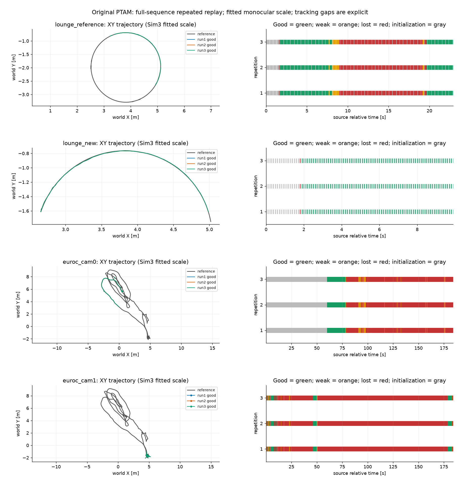

# Damping floor control, 12 November 2026

> Detailed validation record. See [current results](../RESULTS.md) for the main comparison.
> `evidence/` labels identify local validation artifacts; raw logs, app binaries
> and private inputs are not redistributed with this repository.

This completed suite used minimum LM damping 1e-6, with all bounded transactional solver protections, exact native optics and both final tracker safety fixes. Its binary SHA256 was `e57d5d362330cd41325bdee4e58b36a1dddd3fae965a68278f3494db87f2f4be`. It is retained as a rejected tradeoff, not the selected default. The final default-transaction suite is reported separately.

Evidence root: `evidence/host/final_production_20261112`. The directory name records the status before comparison led to rollback; no artifacts were rewritten.

| Input | Init | GOOD / all input, each of 3 runs | Weak | Fitted position RMS | Motion coverage | Largest gap | Hard / retained | Peak RSS | Worst frame |
| --- | --- | --- | --- | --- | --- | --- | --- | --- | --- |
| lounge_reference | 0/16 | 96/230 | 12 | 0.619 cm | 35.91% | 116 frames | 0 / 0 | 81.2 MiB | 68.03 ms |
| lounge_new | 0/18 | 81/100 | 0 | 0.556 cm | 95.62% | 0 frames | 0 / 0 | 46.5 MiB | 31.23 ms |
| euroc_cam0 | 1200/1205 | 365/3682 | 152 | 7.523 cm | 12.57% | 1741 frames | 0 / 0 | 133.6 MiB | 208.42 ms |
| euroc_cam1 | 0/5 | 254/3682 | 90 | 9.162 cm | 3.80% | 2575 frames | 1 / 0 | 66.1 MiB | 37.85 ms |

All three repetitions per dataset produced identical serialized pose/state fields after excluding processing time. Every input exposure was processed; all saved transforms were finite and rigid, and the legacy NaN-loop watchdog never fired. Repeatability and safe execution do not repair the tracking gaps. The floor reduced EuRoC host coverage substantially relative to the transaction-only controls, so the production default was restored to the bounded transaction-only solver. Phone results must be compared separately; small platform-dependent numerical differences can change later tracking and map decisions.

